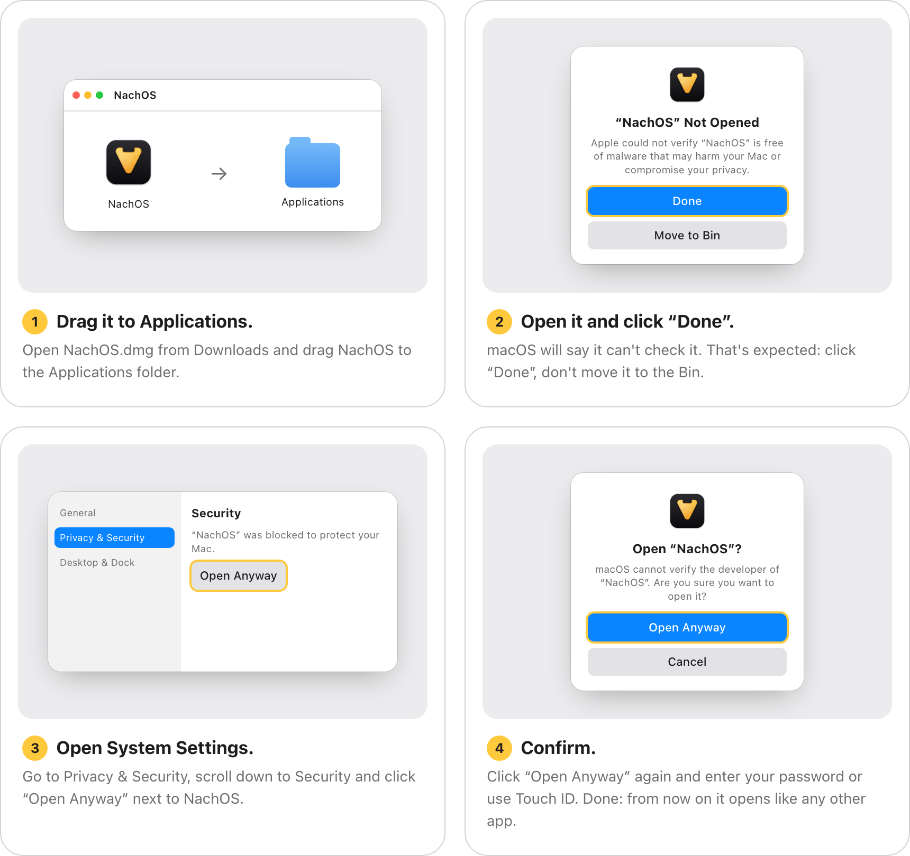

<h1 align="center">NachOS</h1>

<strong>Notchmaxxing</strong> · your notch isn't a flaw: it's a bite.

NachOS turns your Mac's notch into an island like the iPhone's: music with lyrics, window tiling, a clipboard with memory, calendar and tasks, timers, weather, notices and a couple of games. Free.

**Website:** [oriol5000.github.io/nachos](https://oriol5000.github.io/nachos/en/) · [Español](https://oriol5000.github.io/nachos/) · [Italiano](https://oriol5000.github.io/nachos/it/)

## Download

[**Download NachOS for Mac**](https://github.com/oriol5000/nachos/releases/latest/download/NachOS.dmg). macOS 14 Sonoma or later, Apple silicon and Intel, with or without a notch.

Updates arrive on their own, from inside the app.

## This is a beta

NachOS is still a beta and isn't notarized by Apple yet. That's why macOS warns you the first time you open it: it means Apple hasn't checked this build, not that it found anything wrong.

**To open it the first time**, follow these four steps. You only need to do this once:

## Roadmap

1. **Now:** people try NachOS and tell me what they like and what doesn't work.
2. **Next:** fix the flaws and improve what people use most, based on that feedback.
3. **If NachOS reaches a sizeable user base:** get it notarized by Apple, so the warning goes away.

## Bugs and suggestions

Something not working? [Tell me here](https://github.com/oriol5000/nachos/issues). Got an idea? Write to [oriol5000@gmail.com](mailto:oriol5000@gmail.com?subject=Suggestion%20for%20NachOS), or from the app itself: the island's menu → “Send a Suggestion…”.

---

This repository holds the website and the published versions. NachOS is free; its code isn't public.
